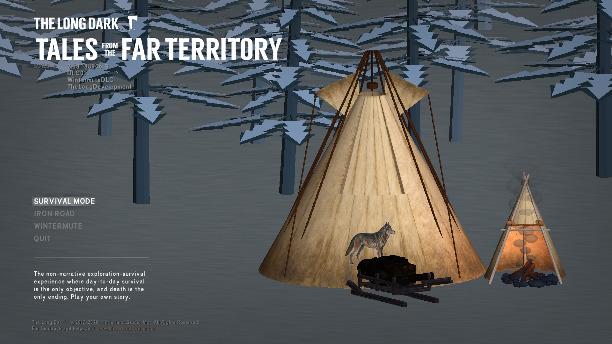

# Burebista Mods — The Long Dark 2.58

## Español
Correcciones de compatibilidad para los mods Burebista en The Long Dark 2.58: tipi y complementos, iglú, ahumador, honda, trineo, perro, castor, trofeos, nieve, setas, menú, equipo inicial y devolución de latas.

**[Descargar RAR](https://github.com/florynstefanache-source/Burebista-Mods-TLD-2.58-Fixes/releases/latest)**

1. Cierra el juego y guarda una copia de tus partidas y de la carpeta `Mods`.
2. Necesitas tus mods Burebista originales y sus dependencias ya instalados. Este paquete es una actualización, no una instalación completa.
3. Extrae el RAR. Copia de `Mods` los archivos correspondientes a tus mods a la carpeta `TheLongDark/Mods`, sustituyendo sus versiones anteriores. No conserves dos DLL del mismo mod con nombres distintos.
4. Para las latas, copia también `BurebistaCanningReturn.dll` y `BurebistaToolsCompatibility.dll`. Para cocinar en el tipi, copia `BurebistaTipiCookwareFix.dll`.
5. Inicia el juego normalmente. No borres otros mods ni contenido necesario para tus partidas.

## English
Compatibility fixes for Burebista mods on The Long Dark 2.58: tipi and addons, igloo, smoker, slingshot, sled, dog, beaver, trophies, snow, mushrooms, menu, starting equipment and empty-can returns.

**[Download RAR](https://github.com/florynstefanache-source/Burebista-Mods-TLD-2.58-Fixes/releases/latest)**

1. Close the game and back up your saves and `Mods` folder.
2. Your original Burebista mods and their dependencies must already be installed. This is an update, not a complete installation.
3. Extract the RAR. Copy the files for your installed mods from `Mods` into `TheLongDark/Mods`, replacing the old versions. Do not keep duplicate DLLs under different names.
4. For can returns, also copy `BurebistaCanningReturn.dll` and `BurebistaToolsCompatibility.dll`. For tipi cookware, copy `BurebistaTipiCookwareFix.dll`.
5. Start the game normally. Keep other mods and content required by your saves.

Burebista · Compatibility pack v1 · The Long Dark 2.58

